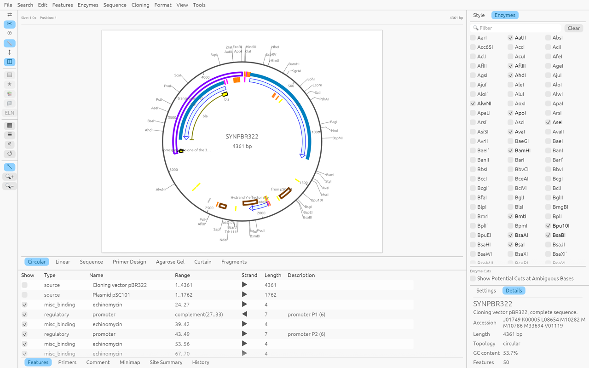
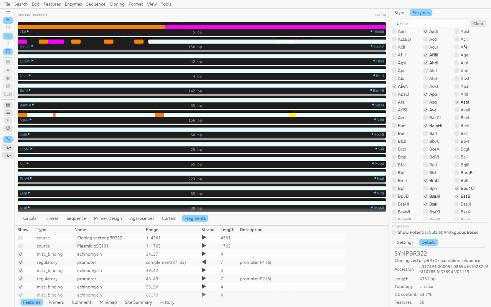
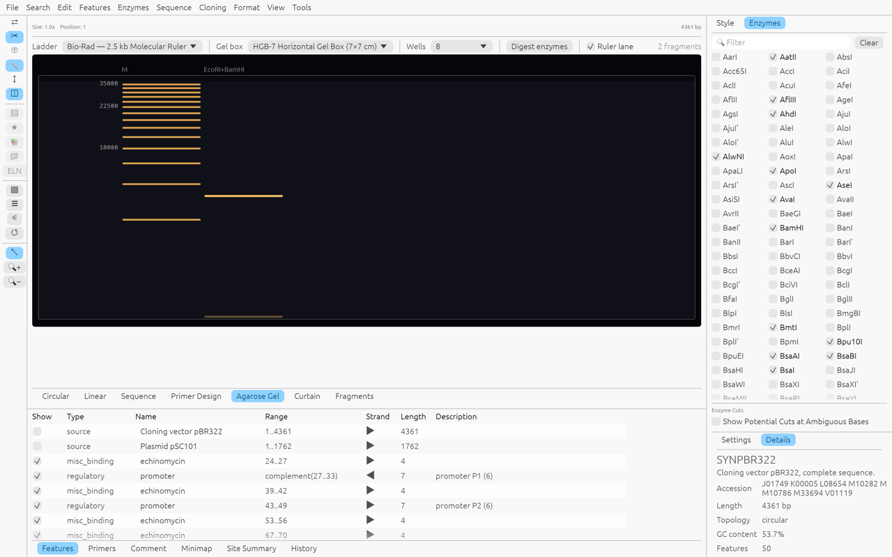
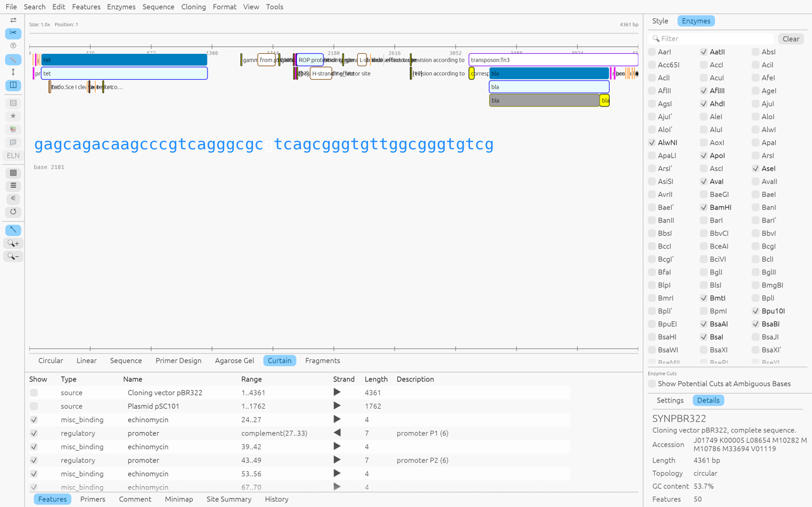

# seqbuilder-rs

A desktop workbench for DNA sequence editing and analysis, written in Rust with
[egui](https://github.com/emilk/egui). It reads and writes common sequence file
formats and bundles everything it needs — enzyme database, gel markers, genetic
codes — so a single binary runs with no installation or setup.



## What it does

**Sequence documents**
- Open GenBank (`.gb`/`.gbk`), FASTA and `.sbd` files; export GenBank
- Circular and linear molecules, with the feature table, per-feature styles,
  qualifiers and statistics in the Details panel
- Full editing: type or paste bases, select ranges, complement, translate

**Analysis tools**
- Open reading frame finder with all NCBI genetic codes (Tools ▸ Find ORFs),
  including codes selected from GenBank `/transl_table` qualifiers
- Restriction enzyme analysis over a bundled database of several hundred
  enzymes: single/double digests, unique cutters, enzyme selector presets,
  site map and site summary
- Primer design view: melting temperature, GC content, self-dimers

**Cloning workflows**
- Restriction insert cloning with overhang compatibility checks (sticky ends,
  5′/3′ overhangs and blunt ends), junction reporting
- Fragment cloning by range
- Gibson / In-Fusion assembly with overlap validation
- The result keeps feature locations, including multi-segment `join()` features,
  on export

**Views**
| View | Purpose |
|---|---|
| Circular | Plasmid map with feature lanes, enzyme sites, ruler and selection |
| Linear | Linear restriction map |
| Sequence | Base-level editing with translation tracks |
| Primer Design | Primer candidates and pair analysis |
| Curtain | Presentation view — feature curtains in lanes with a large central sequence band |
| Fragments | The sequence cut by the shown enzymes, block per fragment with boundary enzymes |
| Agarose Gel | Digest simulation — molecular ruler lanes, log-linear migration, band brightness by mass share |





**Online search**
- Search ▸ Search for Sequences… submits the open sequence to NCBI BLAST
  (blastn) and lists hits with identity, bit score and e-value, plus the
  query/midline/subject alignment of the selected hit

**Output**
- File ▸ Print… (⌘P) writes the printed layout of the whole document —
  numbered 60-base rows grouped in tens and the feature table — as a PDF;
  Print Selection… (menu only) prints the selected range instead



## Build from source

The Rust crate lives in `seqbuilder-rs/`:

```bash
cd seqbuilder-rs
cargo build --release
```

Requires a stable Rust toolchain. The binary is
`seqbuilder-rs/target/release/seqbuilder-rs`; pass a file to open it, or use
File ▸ Open… / drop a file onto the window.

For screenshot-driven testing, the harness writes a PPM of the Nth frame when
`SEQBUILDER_SHOT=path.ppm` is set; `SEQBUILDER_VIEW` selects the initial view
(`linear`, `sequence`, `primers`, `gel`, `curtain`, `fragment`) and
`SEQBUILDER_GEL="EcoRI,BamHI"` picks gel digest enzymes.

## Windows builds

The repository's GitHub Actions workflow builds a portable Windows binary
(runnable from any folder, no installer) on every dispatch. Download the
`seqbuilder-rs-windows-portable` artifact from the workflow's
[Actions page](https://github.com/dreryos/seqbuilder-rs/actions/workflows/build-windows.yml) —
trigger a run with *"Run workflow"* if the latest one predates a change you
need.

## Project layout

```
seqbuilder-rs/
  src/          application code — views, tools, cloning, gel, BLAST, PDF output
  assets/       bundled data — enzyme database, gel markers, gel boxes
  testdata/     sample sequences used by tests and the screenshot harness
docs/           development notes and the implementation gap analysis
```

## Status

Implemented and tested: ORF finder, genetic codes, restriction analysis,
enzyme selectors, cloning suite, gel simulation, curtain and fragment views,
BLAST search, PDF printouts, primer design.

Planned: feature library with auto-annotation.
